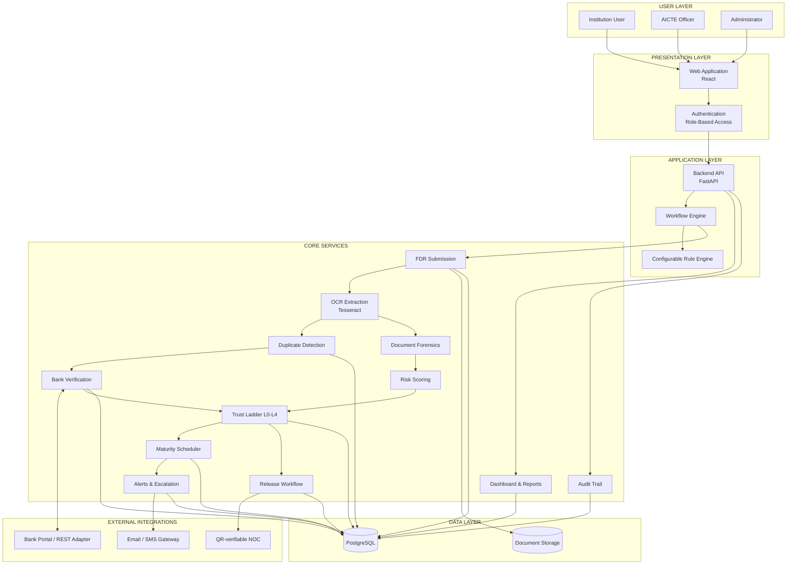
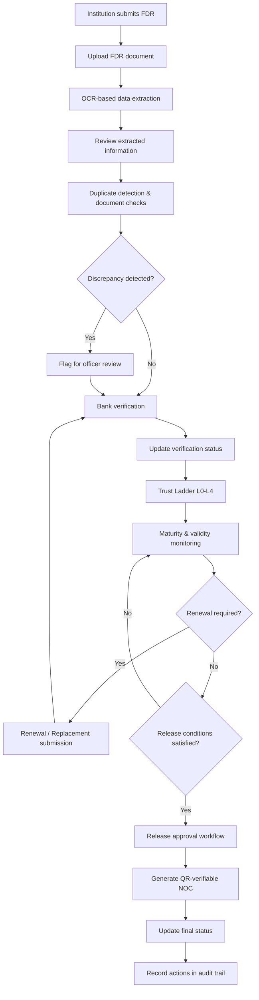

# AMANAT
### Smart FDR Verification, Security & Lifecycle Management System

**AMANAT** is a digital platform proposed for streamlining the submission, verification, monitoring and release of Security Deposits and Fixed Deposit Receipts (FDRs) within AICTE.

The system brings the complete FDR lifecycle into one platform, from initial submission and document verification to maturity tracking, renewal, approval and final release. It combines OCR-based document extraction, duplicate detection, bank verification support, automated reminders and a tamper-evident audit trail.

The objective is to reduce manual verification, identify suspicious or duplicate FDR submissions, prevent missed deadlines and improve transparency in the management of institutional deposits.

---

## Project Overview

| Detail | Information |
|---|---|
| Project Name | AMANAT |
| Full Name | Smart FDR Verification, Security & Lifecycle Management System |
| Hackathon | Smart India Hackathon 2026 |
| Problem Statement ID | SIH26265 |
| Problem Statement | Streamline of Security Deposit/FDR Portal |
| Theme | Smart Automation |
| Category | Software |
| Team Name | JanHash Tacklers |
| Team ID | 199469 |

## The Problem

Security deposits and FDRs are important financial instruments used in institutional processes. Their management involves several stages, including submission, document scrutiny, bank verification, validity monitoring, renewal and release.

When these activities depend on scattered records and manual follow-ups, several problems can arise:

- Difficulty maintaining a centralised record of submitted FDRs.
- Repeated manual verification of financial documents.
- Risk of forged, altered or duplicate FDR submissions.
- Delays in obtaining confirmation from issuing banks.
- Missed maturity dates and renewal deadlines.
- Limited visibility into pending verification and release requests.
- Difficulty maintaining a reliable history of actions and approvals.

AMANAT aims to address these issues through a unified digital workflow.

## Proposed Solution

AMANAT provides a centralised FDR register supported by document verification and lifecycle monitoring.

Institutions can submit FDR details and supporting documents through a digital portal. OCR extracts relevant information from the uploaded documents, reducing repetitive manual data entry. The system then performs duplicate checks, document analysis and discrepancy detection.

Bank verification is supported through a secure integration channel. Each FDR is assigned a verification status through the proposed **Trust Ladder (L0–L4)**.

Once an instrument is verified, the platform monitors its validity and maturity dates, manages renewal or replacement records, and tracks release requests through a configurable approval workflow.

Dashboards, automated alerts and a tamper-evident audit trail help officials monitor the complete process.

## Key Features

### 1. Digital FDR Submission
- One-time digital FDR filing.
- Centralised instrument register.
- Institution-wise FDR records.
- Supporting document management.

### 2. OCR-Based Data Extraction
- Extracts relevant fields from uploaded FDR documents.
- Reduces manual data entry.
- Makes extracted information available for verification.
- Supports document scrutiny and discrepancy checks.

### 3. Document Verification and Fraud Detection
- Duplicate FDR identification.
- Document fingerprinting using SHA-256.
- Document forensics and image analysis.
- Risk scoring to flag suspicious records.
- Bank confirmation through an authorised verification channel.

### 4. Trust Ladder (L0–L4)
A structured verification-level framework that displays the status of each FDR and helps officials distinguish between submitted instruments and those that have undergone further verification.

### 5. Maturity and Renewal Monitoring
- Automatic maturity tracking.
- Renewal and replacement records.
- Scheduled reminders before expiry.
- Monitoring of pending renewal actions.

### 6. Release and Refund Workflow
- Rule-based release eligibility checks.
- Multi-level approval workflow.
- Tracking of pending release requests.
- QR-verifiable NOC generation after approval.

### 7. Dashboard and Reporting
- Institution-wise FDR overview.
- Verification and discrepancy status.
- Maturity and renewal monitoring.
- Pending approvals and release requests.
- Reports for administrative monitoring.

### 8. Audit Trail and Security
- Hash-chained event history.
- Traceable user actions.
- Role-Based Access Control.
- Document integrity checks.
- Secure handling of institutional records.

---

## System Architecture

The following diagram represents the proposed high-level architecture of AMANAT.

## FDR Lifecycle Workflow

AMANAT follows the FDR from its initial submission to final release.

## Technology Stack

The proposed architecture uses established technologies for document processing, workflow automation and secure data management.

| Layer | Technology | Purpose |
|---|---|---|
| Frontend | React | Web portal and dashboards |
| Backend | Python, FastAPI | API development and workflow management |
| Database | PostgreSQL | Structured FDR and institutional records |
| OCR | Tesseract OCR | Extracting information from FDR documents |
| Image Processing | OpenCV | Document preprocessing and image analysis |
| Document Integrity | SHA-256 | File fingerprinting and integrity checks |
| Duplicate Detection | Hash-based matching | Identifying identical document submissions |
| Risk Analysis | Rule-based risk scoring | Flagging suspicious records and discrepancies |
| Workflow | Configurable Rule Engine | Approval and release management |
| Scheduling | Background Scheduler | Maturity reminders and renewal monitoring |
| Bank Integration | REST API Adapter | Supporting bank-side verification |
| Security | RBAC and Encryption | Access control and data protection |
| Audit | Hash-chained Event Log | Maintaining traceable activity records |

### AI/ML and Document Intelligence

AMANAT uses OCR and document analysis to assist the verification process.

**Tesseract OCR:** Used for extracting printed information from uploaded FDR documents. Tesseract 4 and later versions include an LSTM-based OCR engine.

**SHA-256 Hashing:** Generates a document fingerprint to identify identical files and support integrity checks.

**Duplicate Detection:** Compares document fingerprints and relevant FDR details to flag possible repeated submissions.

**Document Forensics:** Supports checks for suspicious document modifications and inconsistencies.

**Risk Scoring:** Applies configurable rules to flag records requiring additional scrutiny.

The system is designed to assist authorised officials. OCR output and risk flags are not treated as final proof of authenticity or fraud.

---

## Trust Ladder (L0–L4)

The Trust Ladder is a proposed verification framework for displaying the verification status of an FDR.

| Level | Purpose |
|---|---|
| L0 | Initial submission recorded |
| L1 | Document and extracted details reviewed |
| L2 | Duplicate and discrepancy checks completed |
| L3 | External/bank verification recorded |
| L4 | Verification requirements completed and status confirmed |

The exact transition conditions between levels can be configured according to AICTE's verification rules and available bank integration.

## Security and Data Integrity

AMANAT incorporates security measures to protect financial records and maintain accountability.

- **Role-Based Access Control:** Restricts access according to user responsibilities.
- **Document Fingerprinting:** SHA-256 hashing supports document integrity checks.
- **Hash-Chained Audit Log:** Helps identify unauthorised changes to recorded events.
- **Encrypted Storage:** Protects sensitive documents and institutional information.
- **Bank Verification:** Supports confirmation through authorised bank channels.
- **Approval Tracking:** Records the stages and actions involved in release requests.
- **Human Oversight:** Final verification and approval decisions remain with authorised officials.

## Core Modules

| Module | Responsibility |
|---|---|
| User Management | Authentication and role-based access |
| Institution Management | Institution profiles and records |
| FDR Register | FDR submission and instrument tracking |
| OCR Processing | Document text extraction |
| Verification Engine | Duplicate checks and discrepancy identification |
| Trust Ladder | Verification-level management |
| Bank Integration | External verification support |
| Maturity Scheduler | Validity and maturity monitoring |
| Renewal Management | Renewal and replacement tracking |
| Release Management | Approval and NOC workflow |
| Notification Service | Reminders and escalation |
| Dashboard | Monitoring and reporting |
| Audit Service | Traceable activity records |

## Implementation Roadmap

| Phase | Development Focus |
|---|---|
| Phase 1 | Authentication, institution records and FDR submission |
| Phase 2 | Document uploads, OCR extraction and data validation |
| Phase 3 | Duplicate detection, document checks and verification status |
| Phase 4 | Maturity tracking, renewal scheduler and notifications |
| Phase 5 | Release approval workflow and NOC generation |
| Phase 6 | Dashboard, audit trail and external integrations |
| Phase 7 | Security testing, validation and deployment |

## Expected Impact

### Financial Security
- Helps identify duplicate and suspicious FDR submissions.
- Supports more reliable document verification.
- Strengthens monitoring of institutional deposits.

### Operational Efficiency
- Reduces repetitive manual data entry.
- Simplifies FDR tracking and verification.
- Reduces manual follow-ups and administrative overhead.

### Transparency and Accountability
- Provides visibility into verification and approval status.
- Maintains a traceable history of actions.
- Improves ownership of pending tasks.

### Long-Term Impact
- Supports nationwide FDR monitoring.
- Enables scalable integration with banks.
- Improves coordination between institutions and AICTE.
- Helps protect public funds through better record management.

---

## Limitations and Integration Dependencies

The following dependencies must be addressed before production deployment:

- OCR accuracy depends on document quality and layout. Extracted information requires validation.
- SHA-256 can identify identical files but cannot independently establish whether an FDR is genuine.
- Live bank verification requires authorised bank-side API access or an approved verification channel.
- Risk scoring can flag suspicious records but does not independently prove fraud.
- QR-based NOC verification requires a secure verification endpoint.
- Production use requires security testing, backup procedures and appropriate data-access controls.

## References

1. **All India Council for Technical Education (AICTE)** – Approval Process Handbook 2024–2027  
   https://www.aicte.gov.in/sites/default/files/APH%20Final.pdf

2. **Reserve Bank of India (RBI)** – Master Directions on Fraud Risk Management in Commercial Banks and All India Financial Institutions, 2024  
   https://systemhealth.rbi.org.in/Scripts/BS_ViewMasDirections.aspx_id%3D12702%281%29.html

3. **National e-Governance Services Limited (NeSL)** – e-BG Resources  
   https://www.nesl.co.in/e-bg-resources/

4. **National e-Governance Services Limited (NeSL)** – API Centre  
   https://www.nesl.co.in/api-centre/

5. **CERT-In** – Directions Relating to Information Security Practices, 2022  
   https://www.cert-in.org.in/Directions70B.jsp

6. **Government of India** – Digital Personal Data Protection Act, 2023  
   https://www.indiacode.nic.in/indiacode/handle/123456789/22037?view_type=browse

7. **Tesseract OCR** – Official Documentation  
   https://tesseract-ocr.github.io/tessdoc/

---

## Team

**JanHash Tacklers**  
Smart India Hackathon 2026  
Problem Statement: SIH26265

**AMANAT — Secure Records. Verified Deposits. Accountable Processes.**
